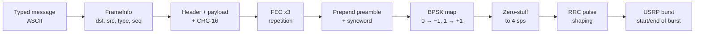
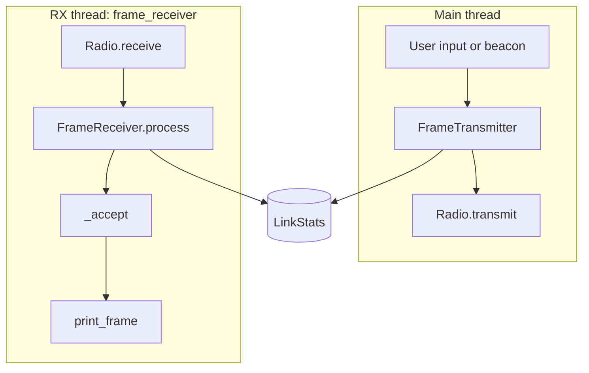
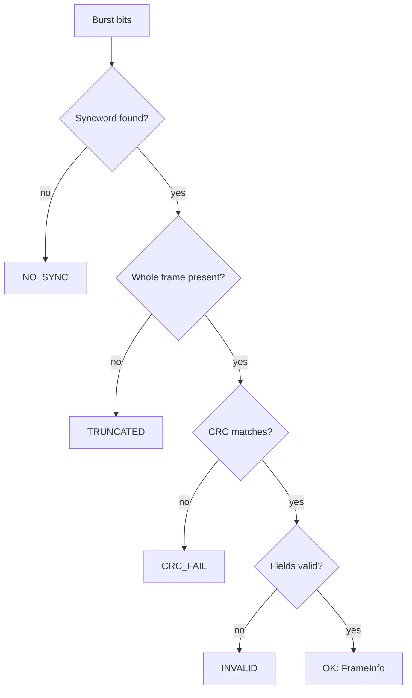

# protoroad: Half-Duplex BPSK Text Chat over SDR

**Package:** `protoroad` (in the `gallant-input` repository)
**Hardware:** Ettus Research USRP B200 series (developed and tested on two B206mini radios)
**Driver:** UHD 4.9 (Python bindings)

`protoroad` sends and receives 32-character ASCII text messages between USRP radios over the
air, in real time, on a single shared channel.  Every DSP block in the chain (modulation,
pulse shaping, burst detection, AGC, timing recovery, carrier recovery, demodulation) is
custom Python; GNU Radio was used only to capture and inspect signals during development.

1. [Part 1: System Architecture](#part-1-system-architecture)
2. [Part 2: Operation](#part-2-operation)

---

# PART 1: SYSTEM ARCHITECTURE

## 1.1 Overview

Every node transmits and receives on the same frequency, taking turns (half-duplex,
single-frequency time-division duplexing).  Frames are short bursts (about 4.2 ms); between
bursts the channel is silent.  Each node runs one program with two threads: the main thread
transmits, and a background thread receives and decodes continuously.

| Parameter | Value | Source |
|---|---|---|
| Modulation | Coherent BPSK, bit 0 → −1, bit 1 → +1 | `constants.BPSK_MAP`, `bpsk.BPSK` |
| Center frequency | 913 MHz (US 902–928 MHz ISM band) | `main.PROTOCOL_CENTER` |
| Symbol rate | 250 ksym/s (250 kbit/s raw) | `main.PROTOCOL_BAUD` |
| Samples per symbol (sps) | 4 | `main.PROTOCOL_SPS` |
| Sample rate | 1 Msps (= sps × symbol rate) | `main.PROTOCOL_SAMP_RATE` |
| Master clock rate | 32 MHz (32 MHz / 1 Msps = integer decimation of 32) | `radio.DEFAULT_MCR` |
| Pulse shaping / matched filter | Root-raised cosine (RRC), α = 0.35, 11-symbol span (45 taps), unit energy | `signals.create_rrc_taps()` |
| Occupied bandwidth | Rs × (1 + α) = 337.5 kHz (±168.75 kHz at baseband) | `main.calc_bandwidth()` |
| Forward error correction (FEC) | ×3 repetition code, majority-vote decoding | `frame.apply_fec()`, `frame.decode_fec()` |
| Error detection | CRC-16/CCITT-FALSE (frame check sequence) | `crc.crc16()` |
| Duplexing | Half-duplex, single frequency (TDD) | design decision |
| Channel access (MAC) | ALOHA: transmit when a message is ready | design decision ([§1.9](#19-channel-access-and-known-limitations)) |
| Byte / bit order | Big-endian / MSB first | design decision |
| Antennas | TX on `TX/RX`, RX on `RX2` | `radio.TX_ANTENNA`, `radio.RX_ANTENNA` |

---

## 1.2 Frame Format

```
| Preamble | Syncword |  FEC x3( Header | Payload | CRC )  | Tail |
|  64 bits |  32 bits | 3 x (40     + 256     + 16) = 936 | 8    |   = 1,040 bits, ~4.16 ms
```

| Field | Size (before FEC) | Contents / purpose | Source |
|---|---|---|---|
| Preamble | 64 bits | `1010…`: a transition every symbol, so AGC, timing, and carrier loops can lock | `constants.PREAMBLE` |
| Syncword | 32 bits | `0x4954CE1F`: marks the frame start and resolves BPSK's 180° ambiguity | `constants.SYNCWORD` |
| Header: dst | 8 bits | Destination address (1–254), or `0xFF` broadcast | `frame.build_header()` |
| Header: src | 8 bits | Source address (1–254) | " |
| Header: type | 8 bits | `MsgType`: `DATA` = 1 (`ACK` = 2 reserved for future ARQ) | `frame_info.MsgType` |
| Header: seq | 8 bits | Per-sender sequence number, 1…255 then back to 1 (0 is never sent) | `frame_info.get_next_seq()` |
| Header: len | 8 bits | Message length in bytes (0–32) | " |
| Payload | 256 bits | The message, padded with spaces to 32 bytes | `frame.build_payload()` |
| CRC | 16 bits | CRC-16/CCITT-FALSE over header + payload bytes | `frame.build_frame_frameinfo()` |
| Tail | 8 bits | Zeros; with 256 zero samples of padding, flushes the RRC filter tail | `frame.build_frame()`, `radio.DEFAULT_TAIL_PAD` |

**Reserved values.**  Address `0x00` is reserved (never a valid source or destination) and
`0xFF` is broadcast (never a valid source).  Sequence number 0 is never sent.  The receiver
rejects any frame that uses these reserved values, which also catches corrupted headers.

**Message vs. payload.**  The *message* is what the user typed (up to 32 bytes).  The
*payload* is the fixed 32-byte field (the message plus padding).  `FrameInfo.message`
always holds the message only.

---

## 1.3 TX Chain



| Stage | What it does | Source |
|---|---|---|
| Frame stamping | Adds this node's address as `src` and the next sequence number | `transmitter.FrameTransmitter.send_message()` |
| Frame bits | Header, padded payload, CRC, FEC, preamble, syncword, tail | `frame.build_frame_frameinfo()` |
| Modulation | Maps bits to ±1 and zero-stuffs to 4 sps (zeros, not repeats, so the result is exactly RRC-shaped) | `bpsk.BPSK.modulate()`, `signals.upsample()` |
| Pulse shaping | Convolution with the RRC taps | `transmitter.FrameTransmitter.build_samples()` |
| Transmission | One burst per frame: start-of-burst and end-of-burst metadata, chunked to the streamer's maximum send size, 256 zero samples appended | `radio.Radio.transmit()` |

---

## 1.4 RX Chain

```mermaid
flowchart LR
    A[USRP RX stream<br/>1 Msps] --> B[RRC matched<br/>filter]
    B --> C[Burst<br/>detector]
    C --> D[Block AGC<br/>per burst]
    D --> E[Gardner timing<br/>recovery]
    E --> F[Costas loop<br/>carrier recovery]
    F --> G[BPSK<br/>slicer]
    G --> H[Syncword search<br/>+ polarity fix]
    H --> I[FEC decode<br/>+ CRC check]
    I --> J[Field<br/>validation]
    J --> K[Address filter<br/>+ LinkStats]
```



The matched filter and burst detector run on every sample and keep their state across
chunks.  Everything after the burst detector runs once per complete burst (*burst mode*):
each burst gets a fresh AGC level and freshly reset timing and carrier loops, which lock on
that burst's own preamble.

| Stage | What it does | Key parameters | Source |
|---|---|---|---|
| Matched filter | Same RRC taps as TX; TX + RX together form a raised cosine (zero ISI at the symbol instants, maximum SNR) | 45 taps | `matched_filter.MatchedFilter` |
| Burst detection | Energy detector: moving-average power vs. a tracked noise floor, with hysteresis | 64-sample window, on +6 dB / off +3 dB, 8,192-sample floor training, pre-pad = preamble + half the RRC span | `burst_detector.BurstDetector`, `main.BURST_DETECT_PRE_PAD` |
| AGC | Block (feed-forward) AGC: scales each burst to RMS 1.0, which puts symbols near ±1 | target RMS 1.0 | `agc.AGC.normalize()` |
| Timing recovery | Gardner TED, cubic Lagrange interpolator, PI loop filter, clamped loop | loop bandwidth 0.02, ζ = 0.707 | `timing_recovery.GardnerTimingRecovery` |
| Carrier recovery | Second-order Costas loop (I·Q phase detector) | loop bandwidth 0.05, ζ = 0.707 | `costas_loop.CostasLoop` |
| Demodulation | Minimum-distance decision against the constellation | | `bpsk.BPSK.demodulate()` |
| Frame sync | ±1 correlation against the syncword, ≤ 2 bit errors; a negative peak means inverted (180°) | `max_errors = 2` | `frame.find_syncword()` |
| Decode + checks | Polarity fix, FEC majority vote, CRC, then field checks (addresses, seq, length, type, padding, ASCII) | | `frame.decode_frame()`, `frame._validate_frame()` |
| Routing + stats | Accept frames addressed to this node or broadcast; drop own echoes; count everything | | `receiver.frame_receiver()`, `receiver._accept()`, `link_stats.LinkStats` |

**Order matters.**  Each stage tolerates the impairments that haven't been corrected yet.
Gardner timing recovery ignores carrier phase, so it runs before the Costas loop.  The
Costas loop needs one sample per symbol at the symbol peak, so it runs after Gardner.  Both
loops' gains assume symbols near ±1, so AGC runs before both.

---

## 1.5 Program Structure (Threads)



- **Main thread:** reads typed messages (or sends the test message in `--debug` mode) and
  transmits them.  Records each sent frame in `LinkStats`.
- **RX thread (`frame_receiver()`):** starts the RX stream, feeds every chunk to
  `FrameReceiver`, records every decode result in `LinkStats`, filters by address, and
  prints accepted frames.  It always stops the RX stream on exit.
- **Shutdown:** Ctrl-C or Ctrl-D sets a stop event, joins the RX thread, and prints the
  `LinkStats` report.  The TX and RX threads write different `LinkStats` counters, and the
  report is printed only after the join, so no lock is needed.

---

## 1.6 Decode Outcomes

Every burst produces a `DecodeResult`, even when decoding fails, because failed frames are
where the bit errors are.



---

## 1.7 Design Decisions

### Why BPSK, 250 ksym/s, and 4 samples per symbol

- **BPSK** is the most robust coherent modulation, and it requires real carrier recovery (a
  Costas loop), which the capstone grades.  A noncoherent scheme such as FSK would skip
  carrier recovery entirely.
- **Symbol rate.**  Assuming ±2 ppm oscillators, two radios can differ by up to ±3.7 kHz at
  913 MHz.  At
  250 ksym/s that's about 1.5% of the symbol rate, within reach of the Costas loop, while
  keeping the sample rate (1 Msps) manageable in Python.
- **4 sps** puts a sample exactly midway between symbols, which is what Gardner timing
  recovery needs, while keeping filters short.  (An earlier prototype used 100 sps, which
  was 25× more computation for no benefit.)
- **The 913 MHz carrier doesn't set the sample rate.**  The radio mixes the signal down to
  complex baseband, so the sample rate only has to cover the signal's bandwidth plus the
  frequency offset: 168.75 kHz + 3.7 kHz < 500 kHz.

### Why RRC pulse shaping (α = 0.35)

The TX and RX RRC filters together form a raised-cosine response: zero inter-symbol
interference at the sampling instants, and an RX filter matched to the pulse for maximum
SNR.  α = 0.35 trades bandwidth (1.35 × Rs) against timing sensitivity and filter length.

### Why this syncword

`0x4954CE1F`

- Peak autocorrelation sidelobe (lower is better; 2 is optimal for 32 bits): **3**
- Integrated sidelobe level: **96**
- Ones / zeros: **16 / 16**
- Longest run of identical bits (starves timing recovery): **5**
- Bit errors needed for a false match in the preamble: **11**

### Why ×3 repetition FEC plus a CRC

Repetition FEC corrects one bad copy out of three.  But when two copies of a bit flip,
majority voting picks the wrong bit, and nothing notices.  The CRC catches that.  In 400
simulated trials per case, with errors that defeat the FEC:

| Bits miscorrected by FEC | Wrong frame delivered, no CRC | Wrong frame delivered, with CRC |
|---|---|---|
| 1 | 170 / 400 | **0 / 400** |
| 2 | 60 / 400 | **0 / 400** |
| 3 | 31 / 400 | **0 / 400** |

The field checks (reserved addresses, sequence 0, length, type, padding, ASCII) stay in
place behind the CRC.  They're nearly free, and they catch the roughly 1 in 65,536
corruptions that a 16-bit CRC misses.

### Why burst mode, and block AGC

The protocol is bursty, so the receiver processes complete bursts: the loops start fresh
on every preamble, and CPU is spent only while a burst is present.  The timing-recovery
block is still stateful (`process()` / `reset()`), so it also works on streams.

A *feedback* (streaming) AGC was tried first.  Between bursts it raises its gain until the
noise reaches the target level, so the next burst arrives 15–35 dB too loud and knocks the
timing loop off lock (0–2 of 4 bursts decoded at high SNR in simulation).  *Block* AGC
measures each burst once and scales it: 4/4 in every case the SNR allowed.

### Why Gardner loop bandwidth 0.02

Starting almost exactly half a symbol off, a Gardner loop can **hang up**: the error signal
is near zero there, and the loop is slow to leave.  At loop bandwidth 0.01, 11 of 300 such
starts failed to lock within the 64-symbol preamble.  At 0.02, all 300 locked.  The cost is
extra timing jitter (see [§1.8](#18-measured-performance)).

### Why Costas loop bandwidth 0.05

Frames decoded in simulation (15 per cell) versus frequency offset:

| Loop bandwidth | 0 Hz | 1 kHz | 2 kHz | 3.7 kHz | 6 kHz |
|---|---|---|---|---|---|
| No Costas loop | 15 | 0 | 0 | 0 | 0 |
| 0.01 | 15 | 14 | 0 | 0 | 0 |
| 0.02 | 15 | 15 | 15 | 0 | 0 |
| **0.05** | 15 | 15 | 15 | **15** | 15 |

0.05 is the narrowest bandwidth tested that covers the ±3.7 kHz worst case.  It cost
nothing at the frame level: 20/20 decoded even at 6 dB SNR.  Coarse frequency correction
was therefore not needed.

### Why ALOHA (for now)

Transmitting whenever a message is ready is the simplest channel access.  With messages
typed by people, collisions are rare (see the on-air results below).  The beacon mode
randomizes its interval (0.1–1 s) so two beaconing radios don't lock into step and collide
repeatedly.

---

## 1.8 Measured Performance

### BER instrument validation (simulation)

The receiver estimates the raw (pre-FEC) channel BER from FEC disagreements: in each
3-copy group, a copy that disagrees with the majority is a channel bit error.  With ideal
timing and phase, the estimate matches BPSK theory, ½·erfc(√(Es/N0)):

| Es/N0 | Theory | Measured |
|---|---|---|
| 4 dB | 1.25 × 10⁻² | 1.23 × 10⁻² |
| 6 dB | 2.39 × 10⁻³ | 2.52 × 10⁻³ |
| 8 dB | 1.91 × 10⁻⁴ | 1.60 × 10⁻⁴ |

### Implementation loss (simulation)

Through the full receive chain at Es/N0 = 8 dB, the raw BER is about 20× theory (roughly
3 dB of implementation loss), dominated by Gardner timing jitter at loop bandwidth 0.02.
Narrowing the loop to 0.005–0.01 brings the BER close to theory, at the cost of occasional
hang-up.  The planned fix is gear-shifting (wide during the preamble, narrow after lock).

### On air: two B206mini radios, both beaconing

Report from one node (address 86) after a run:

```
Bursts detected: 1037, undecoded: 28, radio overflows: 0
Decodes: ok 1009, CRC fail 5, invalid 0, truncated 0, no syncword 23 (FER 0.5%)
Raw BER (FEC estimate): 4.0e-04 (378 of 949,104 bits); syncword BER: 3.1e-05 (1 of 32,448 bits)
Frames sent: 517 (broadcast 517)
Frames from others: 499 (accepted 499, ignored 0); own frames heard back: 510
Frames missed: 5 (1.0% loss)
  Src #179: received 499, missed 5, duplicates 0, restarts 0
```

- **1.0% frame loss and 0.5% FER** with both radios transmitting on pure ALOHA.
- **The 5 missed frames match the 5 CRC failures:** damaged or collided frames were
  rejected, not printed as garbage.
- **A raw BER of 4 × 10⁻⁴** is well within what ×3 repetition FEC can correct.
- **Zero radio overflows:** the RX thread keeps up with 1 Msps in real time.

---

## 1.9 Channel Access and Known Limitations

| Limitation | Effect | Planned approach |
|---|---|---|
| No listen-before-talk (CSMA) | Two nodes can collide; frequent at high traffic, rare with typed chat | CSMA with random backoff after the channel goes quiet.  Prerequisite: split the RX thread into a fast sensing thread and a decoding thread, so channel sensing is much faster than a frame's 4.2 ms airtime |
| No ACK / retransmission (ARQ) | A lost frame stays lost | `MsgType.ACK` and `seq` are already in the frame; add retries and duplicate detection by `(src, seq)` |
| Messages limited to 32 bytes | Longer input is rejected | Fragmentation, with fragments marked in `msg_type` and reassembly per `src` |
| Random addresses can collide (1 in 254) | Two nodes with the same address drop each other's frames as "own" | Choose `--address` explicitly, or add address negotiation |
| Gardner jitter (~3 dB loss) | Lower margin at weak signal levels | Loop gear-shifting |
| Burst detector threshold (+6 dB) | No detection below roughly 5 dB Es/N0 | Threshold derived from a target false-alarm rate (CFAR) |

---

# PART 2: OPERATION

## 2.1 Requirements

- Linux (developed on Ubuntu with UHD 4.9).
- Python 3.10 or newer.
- One USRP B200-series radio per node (B206mini tested), each with antennas on `TX/RX` and
  `RX2`, connected over USB 3.
- Two radios for a two-node test.  They can share one computer (one program per radio).

## 2.2 Setup

From the repository root:

```bash
# 1. UHD driver, Python bindings, and FPGA images (system packages)
sudo apt update
sudo apt install -y uhd-host libuhd-dev python3-uhd python3-venv python3-pip
sudo uhd_images_downloader

# 2. A virtual environment that can still see the system UHD bindings
python3 -m venv --system-site-packages .venv
source .venv/bin/activate
pip install -e .

# 3. Sanity checks
python3 -c "import uhd, numpy, scipy; print('Dependencies: OK')"
python3 -c "import protoroad.main; print('protoroad: OK')"
uhd_find_devices                      # every radio should be listed, with its serial
```

## 2.3 Running

Run one copy per radio, each in its own terminal, from the repository root:

```bash
python3 -m protoroad                          # random address, sends to everyone (broadcast)
python3 -m protoroad --serial 352825E         # use a specific radio
python3 -m protoroad --address 1 --peer 2     # fixed address 1, send only to node 2
python3 -m protoroad --debug                  # beacon the test message, verbose logging
```

| Option | Default | Meaning |
|---|---|---|
| `--serial SERIAL` | First B2xx UHD finds | Which radio to use (see `uhd_find_devices`) |
| `--address N` | Random, 1–254 | This node's address |
| `--peer N` | 255 (broadcast) | Destination for messages you send (1–255) |
| `--debug` | Off | Beacon mode (sends the 32-byte test message every 0.1–1 s) plus verbose logging |

**Two-node chat:**

1. Start `python3 -m protoroad` in two terminals, one per radio.  Give each a `--serial` if
   the second one fails to open a radio.
2. Each prints its address: `[RX] Ready - Address 86: listening for bursts...`.
3. Press Enter at `Press <ENTER> to start`, then type messages (up to 32 ASCII characters).
4. Messages from the other node print as they arrive.  Received messages may appear in the
   middle of a line you're typing; that's cosmetic.
5. Press **Ctrl-C** or **Ctrl-D** to stop.  Each node prints its statistics report.

**Input rules.**  Messages longer than 32 bytes are rejected with a `[TX] Rejected` line
(nothing is sent).  Non-ASCII characters are sent as `?`.

## 2.4 Reading the Report

| Line | Meaning |
|---|---|
| `Bursts detected / undecoded / radio overflows` | Bursts found by the energy detector; how many produced no valid frame; times the radio dropped samples (should be 0) |
| `Decodes: ok / CRC fail / invalid / truncated / no syncword (FER)` | What happened to each burst ([§1.6](#16-decode-outcomes)).  FER counts only bursts in which a syncword was found |
| `Raw BER (FEC estimate)` | Channel bit error rate before FEC, estimated from FEC disagreements (reads low at high BER) |
| `syncword BER` | Bit errors in matched syncwords (counts only syncwords that matched, i.e. ≤ 2 errors) |
| `Frames sent (broadcast)` | Frames this node transmitted |
| `Frames from others (accepted, ignored); own frames heard back` | Valid frames from other nodes, split into "for us or broadcast" and "for someone else"; plus this node's own transmissions, heard by its own receiver |
| `Frames missed (% loss)` | Gaps in other nodes' sequence numbers: frames that never arrived |
| `Src #N: received, missed, duplicates, restarts` | The same, per sender.  A *restart* is a sender whose sequence jumped back to 1 |

## 2.5 Troubleshooting

| Symptom | Likely cause | Fix |
|---|---|---|
| `No devices found` | Radio unplugged, wrong `--serial`, or already in use by another program | Run `uhd_find_devices`; give each program its own `--serial` |
| Second program can't open a radio | UHD tried the radio the first program already has | Give each program its own `--serial` |
| Nothing received | Radios too far apart or gain too low; or (if using GNU Radio to look) bursts too short to see on a waterfall | Move the radios closer or raise `DEFAULT_TX_GAIN` in `main.py`; use `--debug` beacon mode and a waterfall with max hold |
| Many CRC fails or `no syncword` | Weak signal, or receiver saturated by a radio that's too close | Adjust `DEFAULT_TX_GAIN` / `DEFAULT_RX_GAIN` in `main.py` (both default to 30 dB) |
| Many CRC fails while both radios beacon | Collisions (no CSMA yet) | Expected at high traffic; typed chat collides rarely |
| `radio overflows` > 0, or `O` in the console | The host didn't read samples fast enough | Close other heavy programs; avoid USB 2 ports |
| UHD warning about a coerced sample rate | Unsupported rate | `Radio` refuses to start if the rate it gets isn't 1 Msps |

## 2.6 Module Map

| Module | Contents |
|---|---|
| `main.py` | Entry point: protocol parameters, TX loop, thread setup, report |
| `parse_args.py` | Command-line options |
| `constants.py` | Protocol constants shared across modules |
| `radio.py` | `Radio`: USRP setup, burst transmit, continuous receive |
| `transmitter.py` | `FrameTransmitter`: `FrameInfo` → pulse-shaped burst; address and sequence stamping |
| `receiver.py` | `FrameReceiver` (the RX chain) and `frame_receiver()` (the RX thread) |
| `frame.py` | Frame build and decode, syncword search, FEC, validation, `DecodeResult` |
| `frame_info.py` | `FrameInfo`, `MsgType`, sequence-number rules |
| `crc.py` | CRC-16/CCITT-FALSE |
| `bpsk.py` | BPSK modulator and minimum-distance demodulator |
| `signals.py` | RRC taps, zero-stuffing upsampler |
| `matched_filter.py` | Stateful RRC matched filter |
| `burst_detector.py` | Energy-based burst detector with adaptive noise floor |
| `agc.py` | Block AGC (`normalize`) and feedback AGC (`process`) |
| `timing_recovery.py` | Gardner symbol timing recovery |
| `costas_loop.py` | Costas loop carrier recovery |
| `link_stats.py` | Loss, decode, and BER statistics |
| `validation.py` | Shared `ndarray` input validation |
| `convert.py` | Bit / byte / string conversions |
